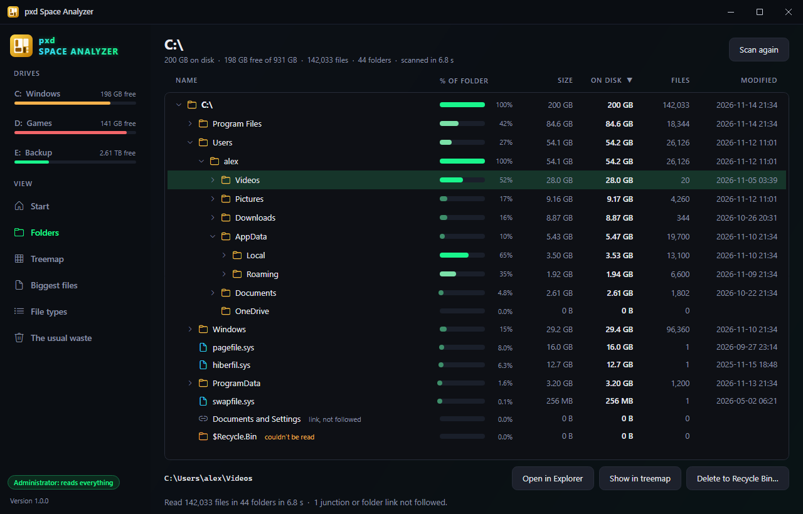
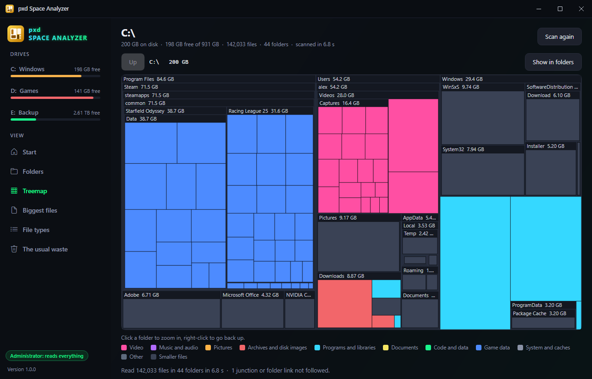
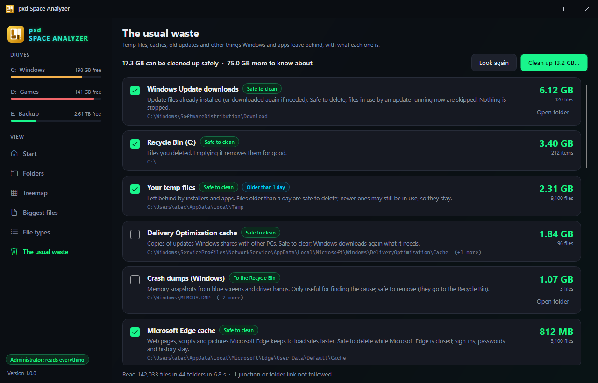
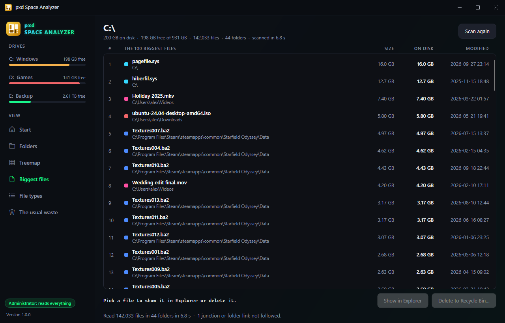
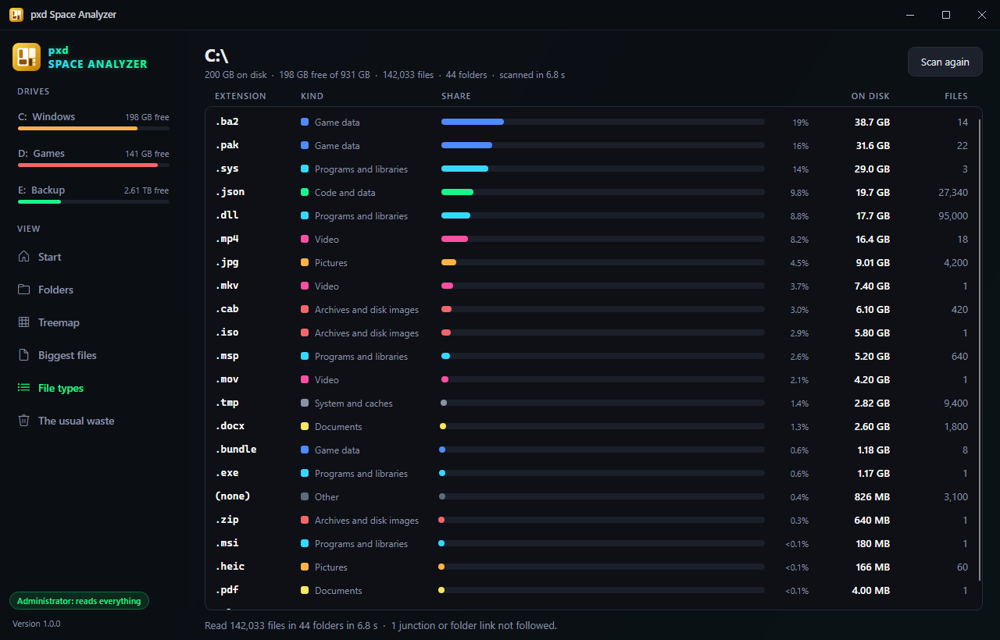
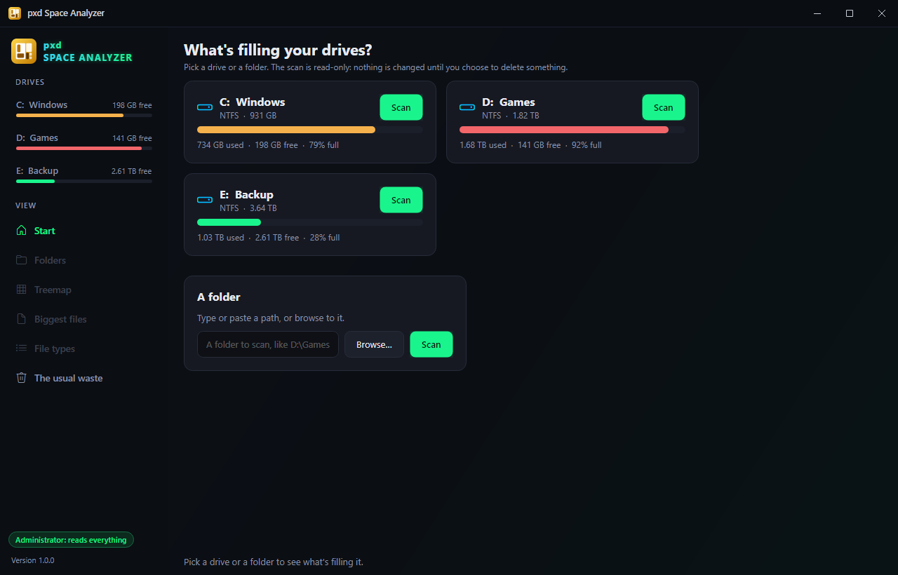
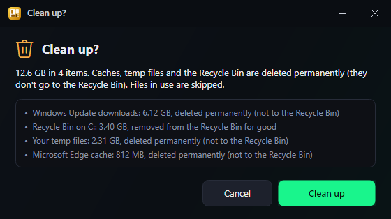

# pxd Space Analyzer

Shows what's filling a drive. Pick a drive (each one shows its used and free space) or a folder, and a fast scan lists every folder biggest first, draws a treemap of every file, finds the 100 biggest files and adds up the space by file type. **The usual waste** page finds what Windows and apps leave behind (temp files, update caches, the Recycle Bin, crash dumps, browser caches and more), says what each one is in plain English, and cleans up the safe ones when you ask.

<p align="center">
  
</p>

## Features

- **Drives at a glance:** every fixed drive with a used/free bar (green, amber when it's over 75 % full, red over 90 %).
- **Fast scan:** several threads share the work, each reading folders with `FindFirstFileExW` (basic info, large fetch). A million files take a few seconds on an SSD. **Progress** shows as it goes, and **Cancel** (or Esc) stops it and shows what was read so far.
- **Size and size on disk:** each file's space on disk is its size rounded up to the drive's cluster size, and compressed, sparse and cloud (OneDrive placeholder) files ask Windows for what they really take.
- **Safe to point anywhere:** junctions and folder links are shown but **never followed** (no counting the same files twice, no loops). Folders Windows won't let you read are skipped quietly, and the window says how many: "N folders couldn't be read (run as administrator)", with a button to restart elevated.
- **Folder tree:** sortable by name, size, size on disk, files or last change, with a bar for each folder's share of its parent. Folders with many small files keep their biggest files by name and count the rest as one line.
- **Treemap:** squarified, every file a rectangle sized by the space it takes and **coloured by kind** (video, music, pictures, archives and disk images, programs, documents, code and data, game data, system and caches). Click a folder to **zoom in**, right-click (or Up) to go back.
- **Biggest files** (the top 100) and **file types** (space and count by extension).
- **Open in Explorer** and **Delete to Recycle Bin** for any folder or file in the tree (it asks first). Windows, program and profile folders, drive roots and the scanned folder itself can't be deleted from here.
- **The usual waste**, each with its size and a note: your temp files and Windows temp files (only files older than a day), Windows Update downloads, the Delivery Optimization cache, Windows.old, each drive's Recycle Bin, hiberfil.sys (with the `powercfg -h off` note), the page file, crash dumps (MEMORY.DMP, Minidump, LiveKernelReports, app crash dumps), error reports, Edge, Chrome and Firefox caches (every profile), the thumbnail cache, the Installer patch cache (`$PatchCache$`, reported only: never delete anything in `C:\Windows\Installer`), your Downloads folder and the component store (WinSxS: never deleted; as administrator, **Analyze** asks DISM for its real figure).
- **Clean up, opt-in and confirmed:** tick the items you want; the dialog lists each one, its size and how it goes. Caches and temp files are deleted for good (they don't go to the Recycle Bin, apps just make them again); crash dumps go to the Recycle Bin; the Recycle Bin is emptied with Windows' own call; Delivery Optimization is cleared with Windows' own cmdlet. Files in use are skipped, never forced, and nothing is stopped. Browser caches are only cleaned while that browser is closed (checked again right before deleting).
- **Runs without administrator rights** (it reads what you can read and cleans your own caches) and offers to **restart as administrator** to read everything and clean Windows' caches. Running as SYSTEM (an RMM tool), it finds the signed-in user's profile and looks at every profile's caches.
- **pxd standard:** dark pxd title bar (the dialogs too), remembers its window, one copy at a time, installed and kept up to date by **[pxd Toolkit](https://github.com/pxdtek/pxdToolkit)**.

| Treemap | The usual waste |
| --- | --- |
|  |  |
| **Biggest files** | **File types** |
|  |  |
| **Start** | **Clean up?** |
|  |  |

## PowerShell edition (nothing to install)

```powershell
irm pxdtek.com/sa | iex
```

A console version in [cli/pxdSpaceAnalyzer.ps1](cli/pxdSpaceAnalyzer.ps1) that runs in memory on any PC, in Windows PowerShell 5.1 and PowerShell 7. It shows the drives with bars, scans a drive or folder (the same fast multi-threaded scanner, compiled once per session; a plain PowerShell walk if that isn't allowed), then lists the biggest folders: type a number to open one, **B** to go back, **F** for the biggest files, **T** for file types. **W** lists the usual waste with sizes and notes, and **C** opens the clean-up menu, which only offers the safe items and asks before each one. **A** restarts it as administrator. It saves nothing on the PC.

```powershell
# print the drives, a folder's biggest folders, files and file types, and the usual waste, then exit
& ([scriptblock]::Create((irm pxdtek.com/sa))) -Report -Path D:\Games -Waste
```

## Supported systems

| System | Status | Notes |
| --- | --- | --- |
| Windows 11, x64 | **Tested** | |
| Windows 10, x64 | Should work, untested | Same file and shell APIs; Delivery Optimization's cmdlet needs 1709 or later (otherwise its files are deleted directly). |
| Windows Server 2016 and later | Should work, untested | |

## Install

- **With [pxd Toolkit](https://github.com/pxdtek/pxdToolkit)** (recommended): pick pxd Space Analyzer and press Install. The Toolkit keeps it up to date.
- **By hand:** download `pxdSpaceAnalyzer-<version>-win-x64.zip` from [Releases](https://github.com/pxdtek/pxdSpaceAnalyzer/releases), unzip it anywhere and run `pxdSpaceAnalyzer.exe`. It needs the [.NET 10 Runtime](https://dotnet.microsoft.com/download/dotnet/10.0).

Each time it starts, it checks for a newer release (at pxdtek.com, or GitHub when pxdtek.com can't be reached) and installs it into its own folder before opening; it just opens when offline. Set `PXD_NO_UPDATE=1` to turn that off. Settings (the tree's sort order and the window's place) are kept in `%APPDATA%\pxdSpaceAnalyzer`.

`pxdSpaceAnalyzer.exe --scan D:\` opens and scans straight away. `pxdSpaceAnalyzer.exe --report D:\ [--waste]` prints the biggest folders, files and file types (and the usual waste) to the console without opening a window.

## Good to know

- Hard links are counted once per link (Windows' own folders, WinSxS most of all, look bigger than they are; that's why WinSxS is reported only).
- The Recycle Bin's size is what Windows reports for your account; emptying it empties yours.
- Sizes use 1024-byte units, like Explorer.

## Build

```powershell
dotnet build -c Release
# the exe's icon and docs/icon.png (optional; a fresh clone builds without them)
bin\Release\net10.0-windows\pxdSpaceAnalyzer.exe --write-icon Assets\pxdSpaceAnalyzer.ico
bin\Release\net10.0-windows\pxdSpaceAnalyzer.exe --write-icon docs\icon.png
```

Checks: `pxdSpaceAnalyzer.exe --self-test <folder>` runs headless (nothing appears on screen) and writes `report.txt` there. It builds a made-up folder tree in the test folder and checks the scan's totals (sizes, sizes on disk, file counts, a path longer than 260 characters, a junction that must not be followed, a folder it isn't allowed to read), the treemap layout, then a made-up PC (its Windows, ProgramData, Users and Recycle Bin, all inside the test folder) for the usual-waste finder and the clean-up: old temp files go and new ones stay, a junction inside temp and what it points to survive, a file held open is skipped, an open browser blocks its cache, report-only items are never touched, and nothing is cleaned without administrator rights where that's needed. It also deletes from the tree inside the test folder, scans a small real Windows folder read-only (compared with .NET's own listing) for speed, renders every page and the confirm dialog to PNGs, and checks the window placement, single instance and update-before-start. Add `--sample` for the README screenshots, which use made-up data.

The PowerShell edition can be tried the same way without touching anything real: set `PXDSA_TEST_ROOT` to a made-up tree (with `Windows`, `ProgramData`, `Users\<name>` and `$Recycle.Bin` inside it) and the usual waste is looked for and cleaned there only; `PXDSA_TEST_RUNNING=chrome` pretends Chrome is open, and `PXDSA_SLOW=1` uses the plain PowerShell scanner. Feed it a file of answers to run it without a window:

```powershell
$env:PXDSA_TEST_ROOT = 'C:\temp\fake-pc'
Start-Process powershell.exe '-NoProfile -File cli\pxdSpaceAnalyzer.ps1' -RedirectStandardInput keys.txt -RedirectStandardOutput out.txt -NoNewWindow -Wait
```
